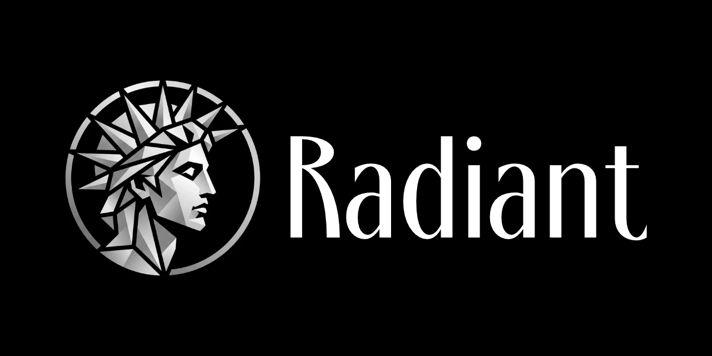

  

<h1 align="center">Radiant for PC</h1>

  A fast, private music player for your own audio files, with a studio-grade equalizer and offline AI stem separation. 
  No ads. No accounts. No telemetry.

  <a href="../../releases/latest"><b>Download the latest release</b></a> ·
  <a href="README_ru.md">Русский</a> ·
  <a href="README.md">Android version</a>

---

## Why Radiant

Most players want you to sign in, stream, or look at ads. Radiant is the opposite: it plays **your** files from **your** folder and does nothing else behind your back.

- **Private by design.** No ads, no accounts, no analytics, no telemetry. Everything stays on your computer. The only network use is downloading the AI model, and only when you press the button.
- **AI stem separation, offline.** Split any track into vocals, drums, bass and other, and save an instrumental, a vocals-only version, or any mix you like as one WAV file. It runs on your PC (CPU or graphics card), nothing is uploaded.
- **App lock.** Protect the app with a 4-digit, 6-digit or custom code. The code itself is never stored, only a salted hash. Wrong guesses are slowed down, and a recovery file with 12 words gets you back in if you forget it.
- **Real sound controls.** 12-band equalizer with 10 presets, a separate curve remembered per track if you want, bass and treble, subsonic filter, volume normalization, mono mode and a soft limiter. With everything off, the audio is passed through untouched.
- **Speed without chipmunks.** Play from 3x slower to 3x faster while the pitch stays the same.
- **Light on resources.** Written in Rust. Small program, no web view, nothing animating when you pause. An optional low-power mode turns off animations and effects for laptops and weak machines.
- **Looks the way you want.** Light, Dark, pure-black (OLED) or follow Windows; 10 accent colors per theme, or pick your own.
- **Your language.** English, Deutsch, Русский, Українська, 中文, 日本語, Français, Čeština, Español, Polski.
- **Free for personal use.** See [License](#license).

## Features

- **Formats:** MP3, FLAC, OGG/Vorbis, Opus, M4A/AAC, ALAC, WAV.
- **Library:** Tracks, Albums, Playlists and Queues. Search and sorting everywhere, drag and drop to reorder. Albums are grouped automatically from tags. Playlists can be put into folders; "Liked tracks" is always there. Four fixed queues for quick listening lists.
- **Music folder:** pick one folder in Settings; Radiant scans it on every start (and with the refresh button). Nothing outside that folder is ever touched.
- **Player:** cover art, quality badge (Hi-Res / Lossless, format, bit depth, sample rate, bitrate), shuffle, repeat, smooth fade on play and pause, accurate seeking.
- **Lyrics:** read from tags or from `.lrc` / `.txt` files next to the track. Synced lyrics scroll with the song; click a line to jump to it.
- **Visualizer:** a spectrum "sun" around the cover art that moves with the music.
- **Track details:** all tags and technical data of a file.

## Download and install

Requirements: **Windows 10 or 11**, 64-bit.

1. Open the **[latest release](../../releases/latest)** and download the Windows build.
2. If it is a `.zip`, extract it to any folder (for example `C:\Apps\Radiant`).
3. Run `radiant.exe`. There is no installer and nothing to set up; the Visual C++ runtime is built in.
4. Open **Settings → Library** and choose your music folder.

Windows may show a *"Windows protected your PC"* (SmartScreen) message, because the program is not signed with a paid certificate. Click **More info → Run anyway**. The source code is public, and every build is made by GitHub Actions from it.

Settings, playlists and models are stored in `%APPDATA%\Radiant`. To remove Radiant, delete the program folder and (optionally) that one.

### AI stem separation setup (optional)

Stems need two extra files that are not bundled, to keep the program small. The rest of the app works without them.

1. **`onnxruntime.dll`**
   - Download <https://www.nuget.org/api/v2/package/Microsoft.ML.OnnxRuntime.DirectML/1.22.1> (a `.nupkg` file).
   - A `.nupkg` is a zip: rename it to `.zip` (or open it with 7-Zip) and take `runtimes/win-x64/native/onnxruntime.dll`.
2. **`DirectML.dll`**
   - Download <https://www.nuget.org/api/v2/package/Microsoft.AI.DirectML/1.15.4>.
   - Open it the same way and take `bin/x64-win/DirectML.dll`.
3. Put both files **next to `radiant.exe`**.
4. In Radiant open **Settings → AI & stems** and press **Download** on the Demucs model (one time, the file is checked after downloading). You can also import the model file by hand.
5. Optional: turn on **Graphics card (GPU)** there for much faster processing. If your card cannot do it, Radiant quietly uses the CPU.

Then right-click a track → **Create stems**, or use the **Stems** tab in the player. Results are saved to `Stems/<Artist - Title>/` inside your music folder and added to a playlist in the "Stems" folder.

## Mobile version

Radiant is also available for Android, with local music, offline playback, an equalizer, AI stem separation and app lock: **[Radiant for Android](README.md)**.

## What's next

Radiant is actively developed. Plans, in no particular order:

- more settings and customization;
- further optimization (CPU, memory, start time);
- interface improvements;
- more interface languages;
- Windows media keys and system playback controls;
- optional one-way download of your music from cloud storage (Dropbox);
- possibly downloading tracks directly from other services;
- support for an NFC key as a way to unlock the app;
- a Linux version;
- an installer and more.

Ideas and bug reports are welcome in the [Issues](../../issues).

## Support the project

If Radiant is useful to you, you can support its development:

  
  

## License

Radiant is licensed under the **[PolyForm Noncommercial License 1.0.0](LICENSE.md)**: free for personal and other noncommercial use. Selling it or publishing it for profit is not allowed.

### Third-party components

[Slint](https://slint.dev) (interface), [symphonia](https://github.com/pdeljanov/Symphonia) (decoding, MPL-2.0), libopus (Opus), [cpal](https://github.com/RustAudio/cpal) (audio output), [rubato](https://github.com/HEnquist/rubato) (resampling), [rtrb](https://github.com/mgeier/rtrb), [ort](https://github.com/pykeio/ort) with ONNX Runtime and DirectML (Microsoft, MIT), [rfd](https://github.com/PolyMeilex/rfd), [ureq](https://github.com/algesten/ureq), [image](https://github.com/image-rs/image), and the **Demucs (htdemucs)** model by Meta AI (MIT). Each is under its own license.

*Radiant is made by john3sobieski.*
